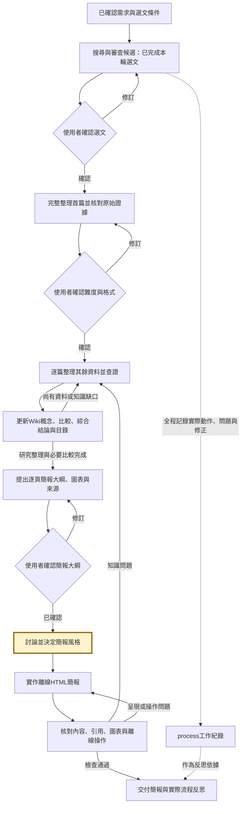

# 自動駕駛 LLM Wiki：專案交接

更新日期：2026-11-21。本文件維護目前需求、狀態與下一步；操作規範見 [AGENTS.md](AGENTS.md)，歷史動作與修正見 [工作紀錄](process/log.md)及[檢查紀錄](process/checks.md)。

## 最新交付狀態｜2026-11-21 純簡報版修訂完成

使用者最新指示：只留簡報本體，移除底部控制列與其他操作功能、全部附錄、講稿及列印PDF；保留隱藏換頁快捷鍵。左下角只列資料來源，不放解釋。以上明確取代先前附錄、講稿與列印需求，後續不恢復這些功能、不重問已確認事項。

已完成 [離線入口](presentation/index.html) 的14頁正式簡報，重建 `presentation-package.zip`。沒有控制列、選單、講稿、全螢幕程式、hash狀態或列印程式／樣式；換頁僅保留方向鍵、PageUp／PageDown、空白、Home／End。已刪除前輪的speaker-notes.md與slides.pdf；三頁風格預覽和歷史檢查圖不作正式入口或交付包內容。

已以主講者角度重寫研究路線、城市背景、公平比較、分心、證據關係與結論；畫面使用中文用途與作者年份，不顯示P01等內部編號。事故率定義、研究期間、不利細組假設、罕見事件區間、資料依賴等必要條件放在正文，來源區只列引用。數值、作者增減幅與區間未變；核心選文與美術確認不重開。

Edge 157.0.4341.60及Chrome 157.0.8103.79無視窗、離線file URL實測14頁鍵盤切換、首末頁界限、移除功能不存在、本機字型與資源；無HTTP請求或程式錯誤。1600×1000全篇畫面逐頁檢視，另全篇檢查1920×1080及1366×768無溢出或來源區重疊；手機僅390×844模擬。未測實體投影機／手機、未實際試講。依使用者取消PDF功能，本輪未產製或驗證列印PDF。

操作與檢查入口見 [README](README.md)、[新版互動檢查](process/presentation_revision2_checks_2026-11-21.json)及[新版交付檢查](process/presentation_revision2_delivery_2026-11-21.json)。下方全文保留階段歷史；其中未實作、12頁、23頁、附錄、講稿與PDF需求均不代表現況。

## 1. 目前狀態與下一步

目前已完成**五篇核心與P04補充的ingest及必要Wiki比較**。使用者先確認「採用此五篇，先整理 P01」，再確認首篇格式並要求「繼續ingest剩下所有的研究」；核心仍為 **P01、P02、P05、P08、P09**，P04作方法補充。六篇筆記、重要證據查核、概念、研究對照、RAVE定性檢視及綜合已完成，見 [Wiki目錄](wiki/index.md)與[綜合](wiki/synthesis.md)。

`raw/papers/` 現存六份PDF：

| 編號 | 資料 | 目前用途 |
| --- | --- | --- |
| P01 | 56.7百萬英里無人營運事故研究 | 已整理，直接比較人類與無車內駕駛的主要實證 |
| P02 | 責任保險理賠研究 | 補充財損與人身傷害理賠視角 |
| P04 | 人類事故比較基準 | 核對主要實證的基準與調整方法 |
| P05 | RAVE研究品質清單 | 檢查比較方法與推論範圍 |
| P08 | 系統安全技術分析 | 解釋系統失效與驗證問題 |
| P09 | 真實人類事故的注意力研究 | 補充不同團隊的人類因素實證 |

以上六篇的核心／補充分工已確認，但不代表六份獨立實證。P03模擬篇與P06混合等級／模式事故樣本篇已依使用者要求刪除，不再列候選。P07自然駕駛研究尚未取得PDF，不影響本輪已確認名單。

六份原始PDF未改寫；P01上一輪核對10頁，其餘本輪新增渲染並實際檢視16頁。各研究重要數值、圖表、模式與推論邊界已核對；P01/P04/P09原稿差異保留於 [Wiki待解問題](wiki/questions.md)。查證表見[P01](sources/P01-evidence.md)與[其餘五份](sources/remaining-evidence.md)。已執行本機連結、六PDF雜湊／頁數及12項簡單算術檢查，結果見[驗證紀錄](process/remaining_checks_2026-11-21.json)。未獨立重跑原始研究，未測Markdown／Mermaid介面，未製作簡報。

**大綱確認已通過（2026-11-21）：**使用者已明確回覆「已確認，更新交接檔案」，確認[逐頁大綱v3](presentation/outline.md)，列12頁主題及提問附錄；以公平比較、道路證據與限定結論為主線。每頁含教學問題、主要訊息、圖表、限制與來源定位。使用者已確認12–15分鐘、多圖表少文字且簡潔，並指出流程與反思和本簡報無關，已移除兩頁流程內容。使用者另要求自然流暢的敘述、優先呈現研究可支持的具體結論並減少重複的不確定性提醒；已修訂為v3，數據區間、不利情境及資料依賴仍保留。逐頁大綱v3已確認，視覺風格留到下一階段；未製作HTML。

**目前階段：美術風格v2已確認，本輪結束於確認與交接；完整實作依使用者明確指示留到下一階段。** 下一階段再依本次更新的大綱v4與已確認的代表頁v2，製作完整14頁主題、提問附錄、講稿及離線HTML，並進行內容、顯示及操作驗證。本輪沒有開始全篇HTML，`presentation/index.html` 尚不存在。三頁測試保留於 [preview.html](presentation/preview.html)；[v2封面](presentation/previews/01-cover-v2.png)、[v2數據頁](presentation/previews/02-evidence-v2.png)、[v2概念頁](presentation/previews/03-concept-v2.png)與[離線預覽包](presentation/preview-package.zip)均已交付。選文、首篇、大綱及美術皆已確認，不重問。完整實作的啟動留待下一階段，不把本輪風格確認當成全篇已完成。

### 大綱開場補充（2026-11-21，本次最新修訂）

使用者要求在封面後新增一至兩頁，先說明研究資料摘要與研究對象／場景。已更新為[大綱v4](presentation/outline.md)：新增第2頁「這份報告用哪些研究回答安全問題？」及第3頁「主要道路證據來自Waymo在美國的營運」，介紹五篇核心加P04補充的用途、Waymo服務，以及鳳凰城、舊金山、洛杉磯、奧斯汀的地理與研究角色。原第2–12頁順延為第4–14頁，主講暫估13分鐘，保留原12–15分鐘目標，未實際試講。新增內容供本次檢視；既有v3與美術v2確認有效，不重開已通過的確認點。

**接手以v4的14頁為準。** 本檔其他12頁／v3文字為先前確認紀錄；完整實作仍留待下一階段，未建立全篇HTML，也未修改既有三頁美術預覽。背景依既有研究範圍介紹，不當作最新營運現況。

### 視覺設計討論（2026-11-21）

**美術風格確認已通過（2026-11-21）：**使用者明確表示「美術風格階段已確認」，採用第二版代表頁的配色、字體、放大字級、精簡單句標題及收攏圖文的排版。使用者隨後明確指示「完整實作在下個階段進行」；本輪僅更新確認與交接，下一階段再製作完整12頁主題、提問附錄與講稿，並進行內容、離線與操作驗證，不重問美術風格。

**最新回饋與修訂：**使用者指出封面中央空白過寬、主要內容字體偏小，標題須精煉且一目了然。測試頁已修訂為v2：封面標題整合為「AI 與人類駕駛，誰更安全？」、插圖向左靠近；內頁正文／圖說／區間／來源字級提高，數據及概念標題改為單行完整句。新版PNG為 `presentation/previews/*-v2.png`，亦同步覆寫原PNG入口與更新ZIP；已逐頁以1600×1000渲染並實際檢視。後續全篇須沿用「精簡單句標題、放大主要文字、縮小無意義空白」原則；不因測試頁回饋重開內容大綱確認。風格已獲使用者確認；完整12頁依指示留待下一階段。

使用者已提出基本要求：文青簡約風；背景可用線條或色塊裝飾；可搜尋符合風格的免費插圖；文字依用途使用不同樣式，亦可使用不同字體。後續授權先實作幾頁測試，並要求改用其他方法交付預覽；已實作封面、數據、概念三頁HTML及PNG，其後v2美術風格已獲使用者確認；此段保留測試階段需求。

已確認美術規格（v2）：16:9；暖白底 `#F6F3EC`、深墨色文字 `#29332F`、霧綠 `#557365`、陶土色 `#B66C50`、淺沙色 `#E7DECF`。思源宋體／Noto Serif TC用於封面與短主標，思源黑體／Noto Sans TC用於正文、圖表與數據；以字重、字級與等寬數字建立用途層級。背景以少量道路線條、裁切圓形或平面色塊構成；數據頁減少裝飾。比較圖維持車隊配色一致，顏色不隨有利／不利結果變換。封面、分心與系統概念頁可用統一系列插圖；數據與機制關係以可核對的本機SVG／HTML圖表呈現。

已查閱免費插圖來源及官方授權：[unDraw授權](https://undraw.co/license)、[ManyPixels圖庫及授權](https://www.manypixels.co/gallery)。兩者允許免費個人／商業專案使用與修改，另有素材包散布等限制；本輪僅查來源，尚未選定或下載圖檔。實際採用時記錄個別素材、作者、來源、授權與取得日期，連同字型及必要資源保存於本機。下一步先依回饋收斂視覺方向，可製作封面、數據、概念三類代表頁預覽，再展開全篇。

## 2. 已確認的任務與研究範圍

- 主題與標題：**AI 駕駛 vs. 人類駕駛：誰更安全？** 不預設答案，結論依研究條件與證據決定。
- 課堂作業：以LLM Wiki整理至少五篇經學術審查的研究，再以Wiki製作初學者可理解的教學HTML簡報。另須交代資訊取得、整理、查證及製作的循環與連結（loop / graph），並根據實際紀錄反思錯誤與流程修改。依使用者後續指示，流程與反思獨立保存於process，不納入這份主題簡報。
- 主要對象：在指定營運範圍與條件內，不需車內人類駕駛的系統。需要人類監督的駕駛輔助須另行說明。
- 至少一篇須直接比較人類與無車內駕駛的**真實事故率及傷勢相關指標**。模擬不占核心名額；其他資料依教學需要補充情境、人類因素、系統安全與比較方法，不必各湊一篇。
- 核心研究須已正式通過學術審查，全文免費公開且可合法下載PDF；僅有預印本或審查不明者不列已合格。官方文件可另作補充。
- 加強研究團隊與原始資料的互補性。接受業者參與，但須揭露關係、資料來源與可獨立核對程度；不同作者、題名或指標不自動代表獨立證據。
- **原始資料可超過五篇。** 依用途與品質決定保留及核心／補充分工，不硬湊分類或國家數量。
- 使用者已授權例行搜尋、合法下載、查證與修正；最終選文仍需確認。

## 3. 教學與交付偏好

讀者具基本認識與資工大二程度，但沒有論文閱讀經驗。使用繁體中文，先說問題與直觀概念，再加入必要術語與技術；公式須解釋符號、用途與意義。中文不足以表意時，首次附英文。

簡報以圖表、比較表及示意圖為主，每頁一個主要教學問題，配合自然流暢的短文字與必要講稿。已確認報告12–15分鐘，目前大綱v4為14頁（新增兩頁開場背景）。優先呈現研究支持的具體結論；適用條件寫進結論，必要限制在相關數據頁交代，避免反覆使用概括的不確定性提醒。具體視覺風格留到下一階段決定。

最終交付為可離線開啟的 `presentation/index.html`，必要字型、圖像、程式與樣式均放本機，README說明開啟方式。內容查證與離線操作須實際檢查並留下結果。

## 4. 三個確認點與後續流程

下圖是整體規劃，**研究整理、Wiki整合與逐頁大綱v3均已完成並通過確認，目前進入「討論簡報風格」階段**。人工確認點用菱形表示；確認未通過時依回饋修訂，再提交同一確認點。

候選階段即可合法下載PDF並登記來源；查核不合格就繼續搜尋。首篇及後續每篇整理都須同步更新相關Wiki頁面。完成條件包含至少五篇研究已整理、必要比較與查證完成、簡報實際檢查通過；反思依全程紀錄撰寫。

1. **選文確認：**提出研究組合、用途、限制及互補性，由使用者確認。
2. **首篇格式確認：**完整整理並查證一篇，請使用者確認難度、深度與格式，再處理其餘研究。
3. **簡報大綱確認（已通過）：**使用者於2026-11-21確認12頁大綱v3；後續先討論風格，再實作HTML。選文與首篇格式確認亦已通過。

整理每篇時同步更新相關概念、比較、綜合結論與目錄。查證發現知識缺漏時回到資料整理；簡報可讀性或操作問題回到呈現修改。流程與實際變更統一維護於 [process/workflow.md](process/workflow.md)。

## 5. 接手查閱位置

| 需要了解的內容 | 檔案／目錄 |
| --- | --- |
| 選文狀態、用途與排除理由 | [sources/selection.md](sources/selection.md) |
| 來源書目、出版查核與現行分工入口 | [sources/catalog.md](sources/catalog.md) |
| 已確認逐頁大綱、圖表與來源規劃 | [大綱v3](presentation/outline.md) |
| 六篇筆記、概念、比較與綜合 | [wiki/index.md](wiki/index.md) |
| P01證據位置及實際查證範圍 | [sources/P01-evidence.md](sources/P01-evidence.md) |
| 其餘五份證據與原稿差異 | [sources/remaining-evidence.md](sources/remaining-evidence.md) |
| 定性品質檢視與本輪檢查 | [RAVE檢視](wiki/comparisons/rave-review.md)、[驗證結果](process/remaining_checks_2026-11-21.json) |
| 第二輪新來源、重審及P01原表核對 | [sources/review-v2.md](sources/review-v2.md) |
| 下載來源、日期、雜湊與移除狀態 | [sources/download_manifest.json](sources/download_manifest.json) |
| PDF檢查與現存／移除狀態 | [sources/pdf_checks.json](sources/pdf_checks.json) |
| 原始學術／官方文件 | `raw/papers/`、`raw/official/` |
| 擷取文字與原頁預覽 | `extracted/` |
| 工作、問題、流程與階段反思 | [log](process/log.md)、[checks](process/checks.md)、[workflow](process/workflow.md)、[reflection](process/reflection.md) |

Wiki已有六篇筆記、共用概念、證據分工、定性方法檢視、綜合及待解問題。簡報目錄目前已有確認通過的大綱v3，尚無HTML。來源文件保留歷史提案，接手先看各檔開頭現況，不能把舊「待選文／格式確認」敘述當目前待辦。

LLM Wiki的概念來源為Karpathy的[原始說明](https://gist.github.com/karpathy/442a6bf555914893e9891c11519de94f)；本專案的目錄與流程是依作業需求設計。

## 2026-11-21｜設計規範獨立整理與修改後自檢

已提取 [設計與驗收規範](presentation/design-spec.md)，區分已確認原則、v2實作參考值與尚未驗證功能；AGENTS.md要求每次修改後主動檢查、修正及複驗。使用者本輪確認桌面Edge／Chrome投影為主、手機只要求可開啟，以及瀏覽器列印PDF每張投影片一頁。下一階段須實測；本輪僅修改文件，未改簡報、重建預覽或驗證播放／列印。全文舊有「風格待確認／12頁」敘述為歷史，接手依v4的14頁與美術v2。本輪未啟動完整實作。
