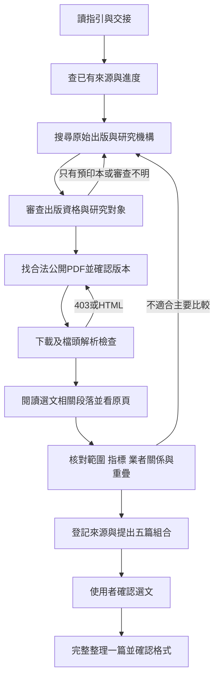

# 工作流程與實際修改

**目前階段更新：**六篇ingest、必要比較與綜合已完成，簡報大綱v3已獲使用者確認；下一步討論風格，再製作HTML。下方v1–v4保留歷史，現況以v5為準；P06已排除，不恢復候選。

## v1｜2026-11-21：選文階段已實行

各節點輸出：C為候選；D為資格判斷與依據；E為精確全文位置及版本；F為不改寫的原始PDF與manifest；G–H為選文審查資料；I為catalog及selection。**目前到I，J尚待使用者決定。**

## 相對於交接流程的實際調整

- **原先：**示意流程將使用者確認後取得PDF列為主要順序，也允許選文時預先下載。
- **本輪：**在選文確認前即取得候選全文、核實檔案及閱讀相關限制，將合法可用全文與版本檢查放在推薦之前。這是已授權例行作業，不新增人工確認點。
- **原因：**本輪實際遇到403、驗證HTML、舊資料API退役、早期稿與接受稿差異。只確認「有PDF連結」不足以代表已取得可用原始文件。
- **取得失敗的回退：**回到合法全文位置查詢，查出版方、作者授權公開稿、大學典藏或官方資料服務；不繞付費牆、不把搜尋摘要當全文。遇到未驗證推測網址，先回查精確檔名。
- **資格與適用性分開：**已審查但對象不同的研究，仍可能不適合核心組合；保留原因，而不是把它誤記成未審查。

後續Wiki知識循環與HTML呈現循環沿用交接文件，尚未執行，不將預期檢查寫成通過。以上修改是否能改善後續階段，目前沒有資料可判斷。

## v2｜使用者指出互補性不足後

在「推薦五篇」之前增加實際適用性檢查，不以書目與PDF合格就視為選文完成：

1. 先把簡報教學問題對應到需要的證據；至少一篇直接提供無車內駕駛里程與人類事故／傷勢相關率。
2. 建立作者、車隊／事故來源、期間與方法依賴矩陣。不同指標或作者均不能單獨證明獨立性。
3. 對照每篇能提供的具體資料與不能支持的主張；模擬移為補充。直接效果、情境分布、機制分析與方法清單分開。
4. 若五篇組合仍重疊或有名額不適用，回到搜尋，不把補滿數量當通過。P06目前仍是有條件候選，尚未解決第五名適用性。

修改原因是第一版真正的選文品質問題由使用者發現；前移的是「教學用途與來源互補」檢查，不只是下載檢查。是否因此減少後續返工，尚無結果可判斷。

## v3｜選文確認通過，P01首篇完成

- 使用者已接受具體五篇及P04補充分工，從選文移至首篇整理；不因接手而重新開始搜尋。資料足夠的意思限於可完成教學組合，不是足以判定所有系統安全。
- 首篇整理先從研究問題、指標和單位建立骨架，再查方法、主表、附錄不利結果及限制，最後連結概念、分工、綜合與待解問題。
- 新增「主表與附錄交叉核對」及「不利細項搜尋」，以處理本輪確實發現的內文差異和摘要範圍問題。只依摘要或只核對主表都不夠。
- 原表值、作者減幅／區間與專案近似重算分開保存；低次數、未達顯著與多重比較限制同步呈現。
- 本輪已完成P01筆記及重要原頁查核，現在停在AGENTS規定的首篇難度／格式確認點；通過後整理其餘四篇。後續流程及簡報大綱確認點不變。
- 驗證邊界：原頁核對與算術檢查不等於獨立重現原始資料分析；尚無資料判斷這次新增檢查能減少多少後續返工。

## v4｜首篇格式確認後，全部研究整理完成

- 已實行順序：使用者確認格式→依各研究設計建筆記→全文與重要原頁交叉讀取→原值／作者估計／專案算術分開→概念及比較→定性品質檢視→綜合→檔案與連結檢查→更新交接。
- 相較v3，將「分析單位與設計能回答什麼」放在各篇結果表之前：P02責任理賠、P09責任勝算、P08技術論證及P05共識不得硬轉為事故率。這是本輪確實依各篇不同設計採用的處理。
- 原頁檢查不只看已擷取文字：P09調整後圖需直接讀圖；P04附錄揭露主文道路名稱的近似；主表與敘述差異要先記錄再寫綜合。新增招募數及倍數／增幅算術核對，以處理本輪看到的原稿差異。
- 符合清單與完成獨立重現分開：已完成15主項的定性閱讀檢視，不建立安全分數或認證。未知原資料維持未知，不以已審查或大樣本自動補足。
- 本機報告生成後再重跑連結掃描，消解首次掃描自身輸出尚不存在的順序問題。後續驗證可直接重跑既有程式，不另外增加框架。
- 六篇筆記與必要比較已完成；下一步逐頁大綱確認，通過前不製作HTML。尚未有證據證明v4會降低簡報返工或整體錯誤率。

## v5｜以主題問題篩選簡報內容

- 使用者要求圍繞主題、每頁少量內容、面向外行人，不將所有研究結論塞入簡報，其他設計細節須討論。
- 本輪先讀交接、Wiki、來源及實際流程紀錄，再依「對象→公平比較→主要證據→限制→回答」提出逐頁稿；每頁標教學問題、單一主訊息、預計圖表、必要限制與來源。
- 相較v4的完整研究整理，簡報階段增加內容取捨：主頁只選一組數值比較，完整結果與公式留附錄；不利細組、罕見傷亡不確定性與證據依賴仍留主線。
- 報告時間、風格及作業流程位置先提出討論；12主題頁＋2流程頁是暫案。確認後才製作HTML，沒有新增人工確認點。
- 本輪僅提出大綱與對照既有證據，未新增外部研究、生成圖像或執行簡報介面／離線測試；尚無聽眾試講或篇幅改善成效。

### v5後續回覆：專注主題的12頁版本

使用者確認12–15分鐘、多圖表少文字且簡潔，並說明流程與反思和本簡報無關。已將v1的2頁流程刪除，v2保留12主題頁；流程反思繼續獨立保存，不列簡報內容。時間與風格方向已確認，逐頁大綱仍待確認。

### v5文字修訂：先陳述研究支持的結論

使用者要求自然流暢的敘述，減少反覆強調無法推廣到所有AI的句子。v3將研究對象與指標直接寫進肯定的結果陳述，限制集中在相應數據頁；不利細組、稀少事件區間與資料依賴保留。文字精簡以去除重複為主，不以斷句或刪除條件壓縮篇幅。具體視覺風格移至內容確認後的下一階段，本輪不再要求風格確認。

### 大綱確認通過（2026-11-21）

使用者明確確認大綱v3並要求更新交接。三個確認點均已通過；下一階段依使用者要求先討論視覺風格，再製作HTML。這是既有設計討論的接續，不重開選文、首篇格式或大綱確認。流程與反思獨立保存，不納入主題簡報。

### 美術代表頁預覽（2026-11-21）

使用者授權先做測試頁後，以封面、數據、概念三類代表頁檢查風格，再依回饋展開全篇。原先瀏覽器預覽方式無法成功，依使用者後續指示改交付本機file URL渲染的PNG，讓設計審閱不依賴localhost；互動功能仍須於後續獨立實測，靜態輸出不能代替互動驗證。字型下載改為固定官方完整檔，不將專案文字傳入子集服務。

v2依實際審閱回饋將文字可讀性檢查前移：先設定主要正文與圖解的較大字級，以精簡完整標題、調整圖文位置及移除重複說明解決空間問題，再輸出代表頁檢視；不先完成全篇才發現全體字級偏小。封面須檢查實際可見圖形與文字之間的距離，而非只看SVG外框。

### 美術確認後交接（2026-11-21）

使用者確認v2美術風格，並指定完整實作在下一階段進行。本輪停在確認與交接，完整12頁、附錄及操作驗證尚未啟動；下一階段沿用大綱v3與美術v2直接實作，不重開已通過的確認點。

### 開場背景檢查（2026-11-21，大綱v4）

使用者指出Waymo與鳳凰城等專名缺少背景。原先封面後直接比較駕駛責任，現改為先用兩頁說明研究資料用途、業者及研究地區，再進入原本教學主線。後續內容檢查須在專名首次出現時提供理解所需背景，地圖區分城市定位與實際營運範圍；調整頁數時同步檢查主講時間及內文回指。本次僅修改大綱，14頁主講暫估13分鐘，未試講；不重開原有確認點，完整實作仍留待下一階段。

### 修改後主動驗收（2026-11-21）

原流程將實際驗證集中在代表頁或交付階段；依使用者要求，現改為每輪簡報修改後依presentation/design-spec.md主動檢查受影響範圍，修正並複驗，再交付。大綱／講稿檢查內容與連結，畫面變更須實際渲染，共用樣式檢查全篇；列印變更須實際輸出PDF。新增正式目標為桌面Edge／Chrome、手機可開啟及每張投影片一頁的PDF。尚無實測資料判定流程改善成效。

### 全篇實作與驗收完成（2026-11-21）

依使用者授權實作14頁主題＋9頁提問附錄，沿用已確認三頁。相較僅輸出靜態預覽，這輪增加本機file URL離線互動測試、按鈕焦點情境、兩桌面尺寸、窄螢幕模擬，以及兩瀏覽器實際列印PDF。自動檢查配合逐頁視覺審閱，不以SVG外框超界直接判定構圖錯誤；數據、原始來源與書目也須在交付前重新核對。結果見process/presentation_*_2026-11-21.json。未新增工具框架或人工確認點，實體設備及試講仍列未驗證。

### 純簡報修訂與聽眾檢查（2026-11-21）

使用者最新要求覆蓋原附錄、講稿與列印PDF交付：正式版只有14頁主題與隱藏換頁鍵。流程改為「確認最新功能範圍→以主講者逐頁讀稿→用中文用途替換內部代碼→必要條件回正文、來源區只列引用→刪除DOM／程式／CSS／舊產物→兩瀏覽器離線換頁與全篇畫面→靜態依賴與封包檢查→更新交接」。原始PDF、Wiki與歷史證據仍保存，正式包只收必要依賴。

本輪把「聽眾是否知道這個名詞／研究是什麼」前移到正文撰寫時，把「被移除功能是否仍殘留於共用CSS或封包」列為獨立檢查。來源區不得接回解釋或製作註記。瀏覽器列印PDF驗收已由使用者取消，不再為遵循舊規則而輸出PDF；桌面Edge／Chrome與手機可開啟要求仍保留。不新增使用者確認點。
