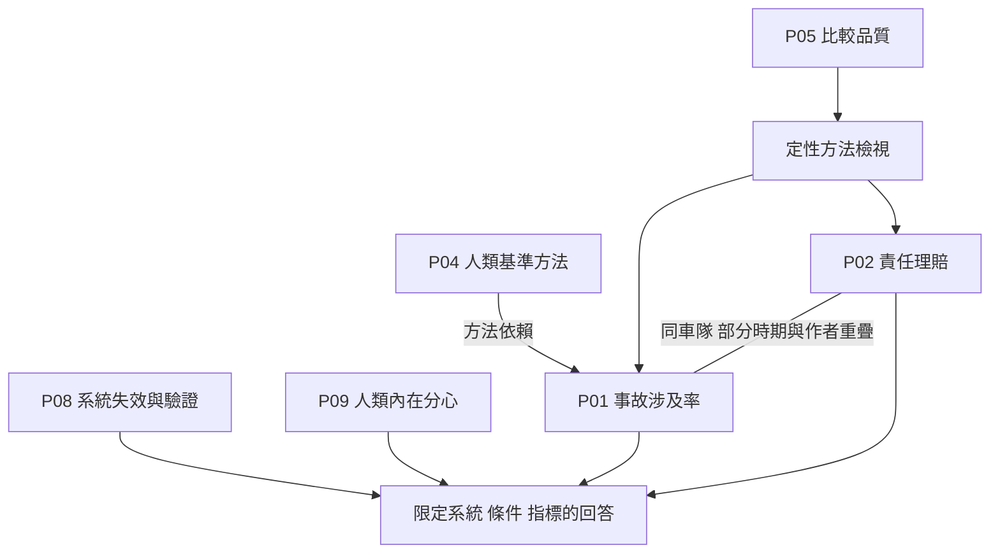

# 六篇資料能一起回答什麼？

2026-11-21：五篇核心及P04補充均已整理並核對本輪重要原頁。以下是**分工與相容性比較，不是排名或效果量合併**。

## 問題與證據類型

| 研究 | 方法／結果 | 系統、地區、期間 | 暴露量／樣本 | 直接安全成效？ |
| --- | --- | --- | --- | --- |
| [P01](../papers/P01-waymo-crash-rates.md) | 觀察性事故涉及率；受傷、氣囊、疑似重傷以上 | Waymo RO；四個主要區域，累積至2025年1月，城市起始年不同；一般道路 | 約5,670萬英里；人類多用2022基準及空間／漏報調整 | 是，限車隊與結果 |
| [P02](../papers/P02-liability-claims.md) | 責任理賠頻率；財損、人身分列 | Waymo RO；舊金山／鳳凰城；總資料2018–2023，人類2016–2021 | RO 3,868,506英里；人類約60萬理賠、估計逾1,250億英里 | 是，限責任理賠 |
| [P05](../papers/P05-rave-checklist.md) | 工作小組15項共識建議 | 主要適用第4級部署後研究；2024年會議形成 | 無新車隊效果樣本 | 否，方法框架 |
| [P08](../papers/P08-system-safety.md) | 跨領域安全論證 | 全自動駕駛設計／驗證；2016稿、2017出版 | 無新事故率；有明標假設的規模例子 | 否，機制與驗證問題 |
| [P09](../papers/P09-mind-wandering.md) | 責任病例對照；調整後勝算比 | 法國單一醫院2010–2011年受傷駕駛，混合車種 | 955人，無里程及AI對照 | 否，人類因素關聯 |
| [P04補充](../papers/P04-human-benchmarks.md) | 人類基準與假想系統檢定力 | 2022美國全國及三郡，道路篩選有近似限制 | 公開事故及估計里程，無新無人車樣本 | 否，P01方法來源 |

缺可對齊的逐次天候、時段、交通密度分布，不能宣稱P01/P02已在所有條件與人類精準配對。P08/P09沒有補上這些缺失。

## P01與P02：方向相近，數字不可合併

| 對齊項目 | P01 | P02 RO | 比較含義 |
| --- | --- | --- | --- |
| 模式 | 無車內駕駛 | 無車內駕駛 | 可對照；不引TO+RO總量 |
| 分子 | 事故涉及車次，按事故結果分類 | 責任理賠件數，按保障分類 | 不同，不能平均減幅或加總事故 |
| 傷害 | 事故有人回報受傷等，含他車人員 | 第三方人身責任請求，無醫學分級 | 非同一傷害率的獨立重現 |
| 地區／道路 | 四區一般道路，空間加權 | 兩區；人類按住址郵遞區號，可能含區外／高速公路 | 範圍不同 |
| 期間 | 至2025年1月，人類多用2022 | Waymo總資料2018–2023，人類2016–2021 | 不同期，車隊暴露部分重疊 |
| 分母 | 政府里程與各項篩選／分配 | 保單年轉估計里程，依兩地權重 | 程序不同 |
| 申報 | SGO／警察門檻及部分漏報處理 | 理賠門檻較一致，仍有未申報及後續發展 | 不能互換分子 |
| 獨立核對 | 部分公開事故與基準，車隊里程自報 | 原始理賠不公開 | 均未在本專案完成分析重現 |

出處依兩篇方法及限制的原頁定位。可將各自結果做分開小圖，共同說明「不同指標出現有利訊號」；不能共用「總安全」長條。P01三項及P02兩類結果均可能重疊。

## 作者與資料依賴

P01/P04全體作者為Waymo員工。P02是Swiss Re與Waymo合作，部分作者、車隊及時期重疊；資料管道不同仍非外部車隊重複驗證。P05有學界、保險及多家業者，部分作者與其他篇重疊；方法共識不新增道路效果樣本。

P08作者為CMU與Edge Case Research，P09主要為法國醫學／研究機構且含Continental作者。它們增加視角與資料互補性，沒有提供另一品牌與人類的每里比較。作者及資料聲明見各篇及[證據紀錄](../../sources/remaining-evidence.md)。

此為文獻依賴與教學分工，箭頭不是統計因果。

## 不利與未確定證據

P01鳳凰城被追撞受傷相關細組較高，另有未達顯著細組；P02零人身理賠仍有非零上界；P09較弱及合併分心無顯著關聯，警察子組的分類分析亦未達顯著。它們的結果、層次或樣本不同，不能當成相同測量互相抵銷。機制解釋須保留假設語氣。

相關：[定性品質檢視](rave-review.md)、[綜合](../synthesis.md)、[待解問題](../questions.md)、[目錄](../index.md)。
