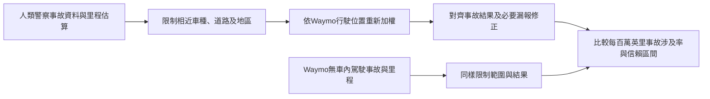

# P01｜56.7百萬英里的無人營運，事故結果與人類有何不同？

**一句話說明：**在這份研究涵蓋的美國營運區域與一般道路上，Waymo無車內駕駛服務的三項傷勢相關事故涉及率，低於作者建立的人類比較基準；這項結果有明確的車隊、條件與方法限制。

狀態：首篇整理及本輪查證完成；使用者已確認難度、深度與格式，其餘研究也已依此完成整理。整理日期：2026-11-21。

## 1. 先問什麼，才能回答「誰更安全」？

假設兩個車隊分別發生十次和二十次事故，光看次數無法判斷安全程度：後者可能開了遠多於前者的里程。還要問，兩邊是否跑在相同道路、事故記錄門檻是否相同，以及這裡的「事故」究竟指碰撞、有人受傷，還是死亡。

P01的問題是：**Waymo在沒有車內安全駕駛監督的實際營運中，每行駛相同距離，涉及特定結果事故的頻率，和相近地區、道路及車種的人類駕駛相比如何？** 這是一項利用既有事故與里程資料進行的觀察性比較，沒有把駕駛者隨機分派到兩組。[原文頁4–7]

## 2. 最少需要知道的背景

本研究的自動駕駛系統屬第4級，在其指定條件內負責駕駛。研究使用無車內駕駛模式（Rider-Only，RO）的里程與事故；RO包含載客及沒有乘員的調度行駛，不表示每一段都有乘客。需要人類持續監督的駕駛輔助不在這項比較中。[頁2、6、19–20、26]

**事故涉及不等於肇事責任。** 車輛停等時遭其他車輛撞上，也可能計入。作者另外討論了誰先發起衝突，但本研究的主要比較沒有依肇責排除事故。[頁16–18、26]

## 3. 研究究竟比較了什麼？

| 項目 | 本研究範圍 |
| --- | --- |
| 系統與車隊 | Waymo第4級、無車內駕駛模式的乘用車服務 |
| 道路 | 一般道路，排除研究定義的高速公路／快速道路；限符合行駛中分類的車輛 |
| 地區 | 主要比較鳳凰城、舊金山、洛杉磯、奧斯汀的營運範圍；再依車隊實際行駛位置調整人類基準 |
| Waymo期間與里程 | 累積至2025年1月底，約56.7百萬英里；表2顯示各地開始累積的年份不同，不是四城同步追蹤 |
| 人類資料 | 以州警察事故資料與州／聯邦里程估算建立基準，多數為2022年，與Waymo並非完全同期 |
| Waymo事故來源 | 美國國家公路交通安全管理局的常設通報命令（NHTSA SGO）資料，另有作者對部分事件的影像／感測及警察紀錄核對 |
| Waymo里程來源 | 業者自報並公開的里程 |
| 主要統計單位 | 每百萬英里涉及具有指定結果事故的車輛數 |

出處：頁5–7／表1、頁10–11／表2、頁19、26–30。不同地區的道路欄位及里程估法仍有差異，不能把「已調整」理解成條件完全相同。

### 三項結果，分別在量什麼？

| 本筆記譯名 | 原文首次對照 | 會計入的情況 | 常見誤讀 |
| --- | --- | --- | --- |
| 有人回報受傷 | Any-Injury-Reported | 同一事故中任何一方回報任意程度傷害 | 把事故涉及率當成每位乘客的受傷率 |
| 有氣囊作動 | Airbag Deployment | 事故序列中任何涉事車輛的氣囊作動 | 把氣囊作動直接當作醫療診斷的重傷 |
| 疑似重傷以上 | Suspected Serious Injury+ | 以警察紀錄的死亡或失能性傷害類別對齊比較 | 說成單獨死亡率，或受傷／死亡人數 |

這三組會重疊，**不能把它們相加成事故總數**。受傷與氣囊也不限於Waymo車內的人或車。[頁9–10、29–30、42–43]

研究要求Waymo車輛有受到直接碰撞；車輛未接觸但可能影響其他車輛出事的情形未納入，原因是人類資料缺少可對齊的分類。因此本篇不能涵蓋車隊可能造成的所有交通安全影響。[頁26]

## 4. 作者如何讓比較接近公平？

此圖是依頁5–10重述的教學示意，沒有新增實測數值。

其中「依行駛位置重新加權」的直觀概念是：假設車隊多在某些街區行駛，就提高那些街區在人類基準中的比重；沒有行駛的區域則不應直接套入。這比直接拿全國平均更貼近問題，但仍未控制所有時段、天候、載客或駕駛特徵。[頁7、18–20]

有人回報受傷的人類基準另做漏報修正；氣囊作動及疑似重傷以上基準未做此修正，因沒有合適估計。因此三個指標的修正方式不同。[頁10、19、29]

## 5. 主要結果：先讀單位，再讀減幅

以下是**作者的研究結果**，取自頁11／表3及頁12／表4「所有地區、按里程混合」列，已看原頁核對。率的單位都是**每百萬英里涉及具有該結果事故的車輛數**；不是傷者或死者人數。

| 結果 | 人類基準率 | Waymo率 | Waymo觀察事件數 | 作者報告的相對減少 | 減少幅度的95%信賴區間 |
| --- | ---: | ---: | ---: | ---: | --- |
| 有人回報受傷 | 4.04 | 0.85 | 48 | 79% | 71%–85% |
| 有氣囊作動 | 1.69 | 0.32 | 18 | 81% | 69%–90% |
| 疑似重傷以上 | 0.24 | 0.04 | 2 | 85% | 39%–99% |

人類基準是經調整的估計，不能把表中的率看成一個與Waymo同樣規模、同步觀測的實驗對照車隊。三項差異在作者的方法下達統計顯著，但**兩次疑似重傷以上事件不足以給出精確、穩定的單獨死亡風險估計**。[頁10–12、15、20、35]

### 怎麼算，才知道自己讀對了？

令 `n` 為符合某一結果定義的涉事車輛次數，`M` 為該車隊行駛英里數，則：

`每百萬英里事故涉及率 r = (n ÷ M) × 1,000,000`

用途是把行駛距離不同的車隊換成共同尺度。例如本研究有人回報受傷的觀察數為48，使用約56.7百萬英里重算：`48 ÷ 56.7 ≈ 0.8466`，四捨五入後約為表中的0.85。這是對發表數字的算術核對，沒有重新驗證原始事件分類或里程。[表3、表4]

令 `r_A` 為Waymo率、`r_H` 為人類基準率：

`率比 RR = r_A ÷ r_H`

`相對減少 = (1 − RR) × 100%`

例如用已四捨五入的0.85與4.04，會得到約79%的減少。**正式報告仍使用作者的減幅及區間，不用已四捨五入的率取代它們。** 尤其0.04與0.24直接相除得到的減幅約83%，不會等於作者以較精細數值算出的85%。重算輸入、公式與結果另存[數值核對紀錄](../../extracted/P01_verified_results.json)。

信賴區間用來表達估計的不確定程度。疑似重傷以上的39%–99%很寬，表示減幅估計仍不精確；不能只挑85%作標語。作者以兩個卜瓦松發生率之比的統計方法估計95%信賴區間；它不涵蓋所有資料偏誤。進一步解釋見[概念頁](../concepts/safety-comparison.md)。[頁10、15、20、35]

## 6. 拆開情境後，有沒有被總平均遮住的事情？

**有。** 以下同時保留較低、未能確定差異及較高的結果，避免將全區平均套到所有情境。

| 情境與結果 | 人類率／Waymo率 | 作者相對差異及95%信賴區間 | 可以怎麼讀 |
| --- | --- | --- | --- |
| 全區車對車路口碰撞，有人回報受傷 | 1.58／0.07 | 減少96%，87%–99% | 主分析中明顯較低；不能等同所有路口每種操作都較安全 |
| 全區車對車路口碰撞，有氣囊作動 | 0.96／0.09 | 減少91%，76%–98% | 提供另一種結果的互補觀察 |
| 全區前後車追撞，有人回報受傷 | 0.61／0.44 | 減少28%；原表差異區間−56%至+12% | 區間跨過零差異，未能確定有差異；不等於證明一樣安全 |
| 鳳凰城被追撞，有人回報受傷 | 0.22／0.48 | **增加117%，11%–281%** | 附錄細分結果較高，須保留；不能由此直接認定Waymo造成事故 |

單位仍為每百萬英里事故涉及率。前兩列見頁13／表5、頁14／表6；第三列見頁13／表5；第四列見頁40／表A9，均已核對原頁。第四列是把追撞拆成「撞上前車／遭後車撞上」的追加分析，人類基準採兩個角色各占一半的假設。[頁39–40]

摘要的「11類沒有顯著較差」不能改寫成「所有細分情境都沒有較差」：鳳凰城被追撞是更細一層的結果。作者未進行多重比較校正；分組愈多，偶然出現顯著差異的機會愈高，因此對較低與較高的細項都要審慎解讀。[頁16、20、39–41]

洛杉磯的三項整體比較未達顯著，不能說四個城市逐一都已證實較低。例：有人回報受傷的差異區間為−80%至+12%，仍涵蓋零差異；疑似重傷以上雖觀察為零，也不是風險為零。[頁11、31／表A4]

## 7. 研究結果、作者解釋與本專案判讀

| 層次 | 內容 |
| --- | --- |
| 研究結果 | 在作者界定與調整的比較中，三項全區整體事故涉及率較低；部分細分結果未達顯著，鳳凰城被追撞受傷相關率較高。出處如上述原表。 |
| 作者解釋 | 作者認為路口、單一車輛事故及弱勢用路人等類別的減少，是整體改善的重要來源，並主張部分未修正因素可能使比較較保守。[頁15–21、35–36] |
| 本專案綜合判讀 | 這提供特定無人營運服務的實際安全成效證據，但仍須把事故定義、基準假設、稀少事件與來源依賴一起呈現。多個指標方向一致增加可理解性，並不等於已排除所有偏誤。 |

## 8. 主要限制與可獨立核對程度

- **來源與利益關係：**全部作者受僱於Waymo。事故通報及里程有公開部分，但里程自報，部分事件分類用到業者感測與影像資料；本專案未取得全部底層紀錄，不能宣稱已獨立重建研究。[頁22、26、30]
- **基準不是完全同期、同條件：**多數人類基準來自2022年，車隊大部分里程較晚；未完整調整時段及其他條件，人類里程與部分車種分類也經估算。[頁10、18–20、27–29]
- **漏報修正有假設：**使用全國估計推估地方受傷事故漏報，不能保證每個城市相同。附錄顯示整體受傷及氣囊結果的方向較不依賴這些調整；疑似重傷以上的城市別顯著性則會受空間調整影響。[頁19、29、34–36]
- **乘員配置影響問題定義：**無乘員的車不會產生該車乘員傷害，但仍可能涉及其他人的傷害。這是服務整體效果的一部分，同時表示資料不能直接回答「同樣載滿人時，每個人的受傷機率」。作者以氣囊作動提供較不受乘員有無影響的互補指標；它仍不是人體傷勢。[頁19–20]
- **傷勢資訊較粗：**以通報及警察傷勢分類為主，沒有依醫療紀錄編碼的完整AIS傷勢資料。三起SGO標為嚴重／死亡的案例中，一起因警察紀錄僅為疼痛申訴而未納入疑似重傷以上；本專案核對的是作者的說明，未獨立取得三份警察原始報告。[頁9、20、41–43]
- **低次數與多重比較：**疑似重傷以上只有兩次，且多個結果、城市及情境反覆比較，未作多重比較校正。不能把每個分組顯著值當成同樣穩固的獨立證明。[頁15、20、35]
- **沒有評估全部影響：**排除未直接碰撞的事件，未完整量化部署後改變交通里程、其他交通方式與道路行為的總效果。[頁20、26]

另見[待解問題](../questions.md)：接受稿本身有幾處數字或文字不一致，已保留定位，不自行修訂原文，也不在教學中混用。

## 9. 可支持與無法支持的結論

**可支持的表述：**「在研究的營運區域、道路與期間內，Waymo無車內駕駛服務相對作者調整的人類基準，三項整體傷勢相關事故涉及率較低；結果仍受基準、分類及觀察性資料限制。」

**無法由本篇支持：**所有自動駕駛都優於所有人類、死亡率降低85%、所有城市與情境都較低、零事故代表零風險、差異全由AI技術單獨造成，以及研究涉及事故都由某一方負全責。

## 10. 教學用途與相關頁面

適合先用一個「開得比較多，事故也可能比較多」的小例子教分母，再讀三項主結果，最後用被追撞及兩次重傷以上事件提醒平均值與不確定性。這只是首篇教學用途筆記，尚非已確認的簡報逐頁大綱。

相關：[比較概念](../concepts/safety-comparison.md)、[證據分工](../comparisons/evidence-map.md)、[階段綜合](../synthesis.md)、[待解問題](../questions.md)、[Wiki目錄](../index.md)。

## 原始文獻及引用定位

Kusano, K. D., Scanlon, J. M., Chen, Y.-H., McMurry, T. L., Gode, T., & Victor, T.（2025）. *Comparison of Waymo Rider-Only crash rates by crash type to human benchmarks at 56.7 million miles*. Traffic Injury Prevention, 26(sup1), S8–S20. [正式DOI](https://doi.org/10.1080/15389588.2025.2499887)；[本機作者接受稿](../../raw/papers/P01_kusano_2025_56_7m.pdf)。出版及審查資格見[來源總表](../../sources/catalog.md)。

本文引用「頁」皆指所存58頁接受稿的PDF檢視頁序，從1起算；本輪使用頁的頁底編號與檢視頁序相同。**不可直接換成期刊S8–S20頁碼。** 重要主張、來源位置、查證及衍生計算詳見[查證表](../../sources/P01-evidence.md)。本輪已閱讀正文與附錄相關方法、結果、限制及自評；未宣稱重新執行全部分類、統計與原始資料分析。
