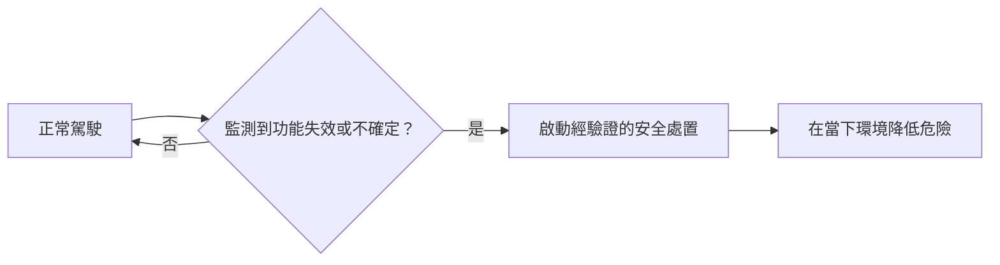

# P08：不會分心的系統，為何仍可能出錯？

一句話說明：自動駕駛安全需要感知、軟體、硬體、失效處置與人機互動共同成立；測試資料上的高準確率不足以單獨證明大型車隊安全。

本篇為已確認核心技術分析，2026-11-21完成整理。Koopman與Wagner（2017），*Autonomous Vehicle Safety: An Interdisciplinary Challenge*，IEEE Intelligent Transportation Systems Magazine 9(1), 90–96。[正式出版](https://doi.org/10.1109/MITS.2016.2583491)、[原始PDF](../../raw/papers/P08_koopman_2017_safety.pdf)。本機為12頁接受稿，內文日期2016年6月，首頁註明2017正式發表；下文用**接受稿頁碼／PDF頁序**，不與期刊90–96頁直接換算。

## 1. 研究問題與必要背景

一輛車在大部分日常情況開得順，和一百萬輛車長期運作時能控制少見危險，是兩個不同要求。本文問：當人類不再負責持續監督與救援，設計與驗證還需要解決哪些相互牽動的問題？

本文是跨領域技術分析，整合既有工程知識與作者經驗，提出問題及可能策略；沒有新的道路事故率樣本、對照試驗或安全減幅。因此「主要結果」是問題結構與論證，不應硬填車隊里程或百分比效果。

## 2. 風險如何跨層次連動？

| 面向 | 作者指出的問題 | 原文位置 |
| --- | --- | --- |
| 安全工程 | 沒有駕駛持續監督時，不能沿用「人類最後會接手」的假設；須有失效後處置 | 頁2–3 |
| 學習與軟體 | 訓練及測試資料未必涵蓋真實道路；遇到新輸入可能沒有可靠保證 | 頁4–6 |
| 硬體 | 備援須搭配潛在故障診斷；多一份零件不自動保證可靠 | 頁5 |
| 測試 | 輸入略變可能造成行為大變；需要判斷安全行為的準則及故障注入 | 頁6 |
| 資訊安全 | 通訊加密不能保證對方傳來的資訊真實，外部設施也可能故障或遭攻擊 | 頁7 |
| 人機互動 | 系統仍須與其他駕駛、行人及自行車互動，行為需可理解 | 頁7–8 |
| 事故追溯與社會期待 | 系統故障時，自己的日誌也需檢查可信度；「比平均人類好」與可接受風險不同 | 頁8–9 |

圖1（頁2）把九個領域連起來，強調它們會互相影響；不是事故肇因比例圖，也不是九項風險的排名。

## 3. 「失效後的安全任務」是什麼？

作者提出縮短任務、降低功能複雜度的方向：主要自動駕駛失效後，由另一機制把車導向安全狀態，例如短時間內減速停車（頁3）。要成立，須能及早偵測失效，且處置機制本身可用、處置方式適合當下環境。

這是本專案依頁3改畫的**概念示意**，不是Waymo實際架構或本文驗證成功的產品。原文舉「保持車道停車」只是可能設計，不能推成任何道路上停在原地都安全。原文也討論等待人類恢復注意再接手的情境；這部分屬有人可接管的系統問題，不是本專案RO車隊有駕駛可救援的證據。

## 4. 為何99.9%準確還不夠？

分類器的準確率，通常只描述它在指定測試資料上的表現；車輛安全還取決於錯在哪、錯誤是否造成危險、下游能否補救，以及實際道路資料是否相似（頁4–6）。本文主張應另外明確定義安全行為，配合獨立監測，而非只依模型正確率（頁5）。

頁6有一個**作者假設例子**：每車每小時10,000次控制操作、100萬輛車，合計每小時100億次操作。作者藉此說明，若想用代表性測試支持極低的災難失效率，需要遠超過100億次測試，且還假設錯誤獨立、樣本具代表性。這些是論證假設，不是任何車隊的觀察事故數，也不是法定里程門檻。

直觀換算可寫：\(N=K\times q\times t\)，其中\(K\)為車輛數、\(q\)為每車每小時操作數、\(t\)為小時數、\(N\)為總操作次數；\(10^6\times10^4\times1=10^{10}\)。這只核對規模，**沒有公式可在本文直接把每次分類錯誤轉成碰撞率**。

## 5. 作者主張與專案推論

**作者主張：**需要從設計到部署的整體安全論證，結合需求、監測、硬體、軟體與測試；僅靠道路測試不足以保證極高可靠性（頁6、9）。這不是主張道路資料沒價值。

**專案推論：**P01/P02回答已發生的營運表現，本篇提醒還要問失效如何被處理及能否外推。這兩類證據可以同時成立：有限條件下事故率較低，仍存在罕見或未涵蓋的系統風險。本篇沒有測量P01車隊，不足以判定該車隊目前每項機制做得如何。

## 6. 限制與業者關係

文章較早，標準、法律與產業部署的描述反映當時背景；本輪用來教一般工程問題，**不當成2026年現行標準、法規或技術能力盤點**，也不宣稱2017年提出的每個問題至今均未解決。文中引用其他研究的成效或可靠度目標，未逐篇取得原始文獻重驗。

Koopman列Carnegie Mellon University，Wagner列Edge Case Research且為執行長／共同創辦人，並有研究機構關係（頁1、11–12）。有安全工程服務業關係，不能簡化為「完全無業者關係」。本篇不提供新資料集，無法做車隊數據重算。

## 7. 能支持、不能支持與教學用途

能支持：不依賴人類監督後，系統必須另行處理故障與未知情況；安全證據需涵蓋多個層次。不能支持：自動駕駛必然比人類差、某品牌已解決所有風險、特定事故必定由某感測器造成，或99.9%模型準確等於99.9%駕駛安全。

教學可用「看見→判斷→控制→監測／安全處置」示意，搭配[P09人類注意力](P09-mind-wandering.md)，但不畫成已證實一對一替代的肇因占比。相關：[系統與人類風險概念](../concepts/outcomes-and-odds.md)、[證據分工](../comparisons/evidence-map.md)、[綜合](../synthesis.md)、[目錄](../index.md)。
